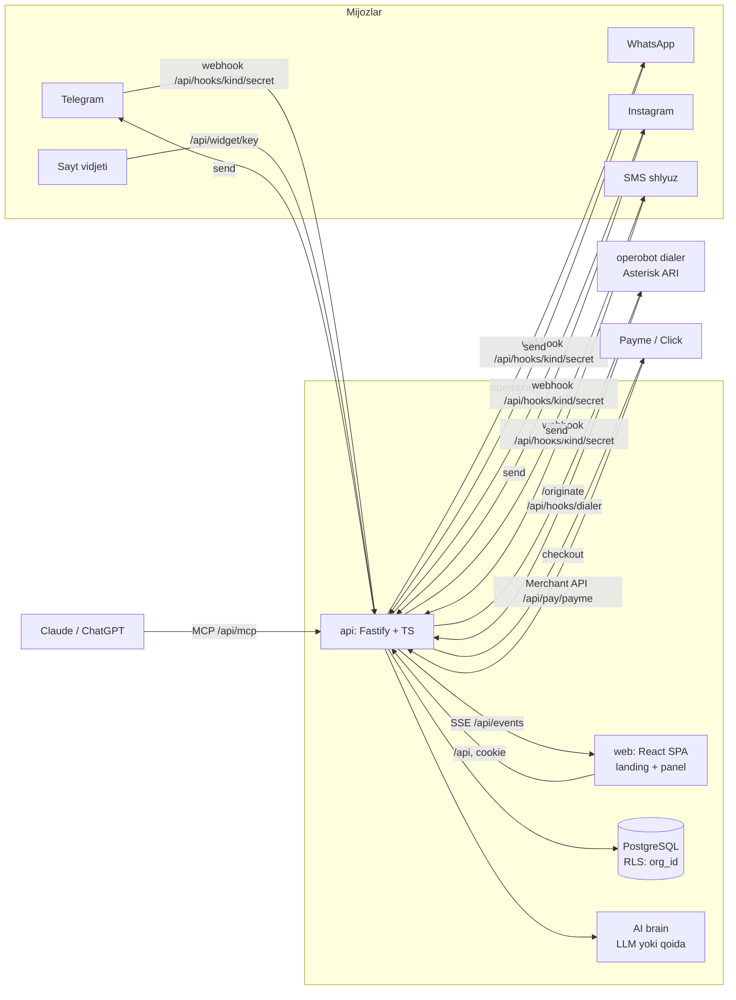
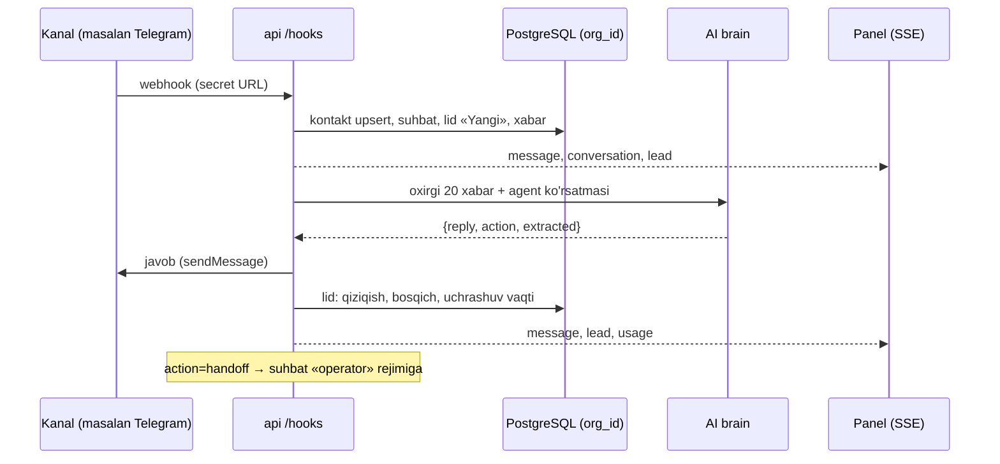

# 02 · Arxitektura

## Kiruvchi xabar oqimi

## Qatlamlar

| Papka | Mas'uliyat |
|---|---|
| `api/src/db.ts` | Pool, `tx(scope, fn)`: har tranzaksiyada `app.org_id` o'rnatiladi; ilova `ob2_app` rolida ishlaydi |
| `api/src/auth.ts` | scrypt parol, sessiya tokeni (faqat sha256 saqlanadi), `req.ctx`, rollar, org API kaliti |
| `api/src/flow.ts` | Kiruvchi → lid → AI → chiquvchi; `applyExtracted` |
| `api/src/channels/` | Har kanal: `connect`, `send`, `parse` |
| `api/src/ai/brain.ts` | LLM (OpenAI-mos) yoki qoida asosidagi o'zbekcha javob |
| `api/src/voice/calls.ts` | Kampaniya navbati, qonuniy oyna, simulyatsiya yoki dialer |
| `api/src/billing/` | Tariflar, limit hisobi, checkout, Payme Merchant API |
| `api/src/mcp.ts` | MCP JSON-RPC |
| `api/src/demo.ts` | Sandbox, simulyator, 24 soatlik tozalash |
| `web/` | Landing + panel (hash router), `widget.js` |

## Kengayish

- Bitta API instansi yetadi (SSE xotirada). Bir nechta instans kerak bo'lsa: `bus.ts` → Postgres `LISTEN/NOTIFY`, kampaniya navbati → `select … for update skip locked`.
- Kanal yuborishlari hozir so'rov ichida. Hajm oshsa navbat (`outbox` jadvali + worker) qo'shiladi.
