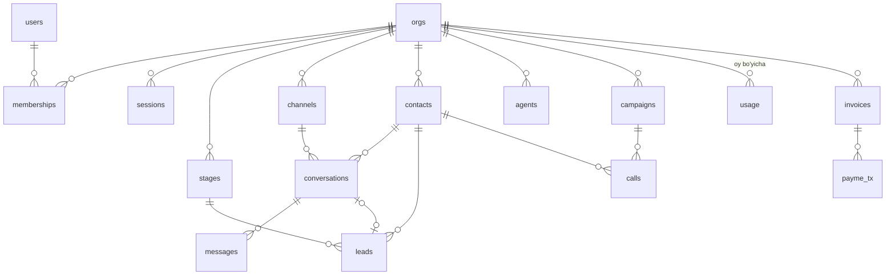

# 03 · Ma'lumot modeli

Manba: [`api/sql/001_init.sql`](../api/sql/001_init.sql). Migratsiyalar `api/sql/NNN_*.sql`, ishga tushganda bir martadan qo'llanadi (`schema_migrations`).

| Jadval | Tenant | Izoh |
|---|---|---|
| `users`, `orgs`, `memberships`, `sessions` | global | Faqat auth kodi (SYSTEM) o'qiydi |
| `stages` … `payme_tx` (12 ta) | `org_id` + RLS | `FORCE ROW LEVEL SECURITY`, policy `tenant` |
| `usage` | `org_id`, `period` (oy boshi) | `messages`, `ai_replies`, `call_seconds`; operator/kanal soni jonli sanaladi |
| `orgs.hook_secret` | — | Dialer webhook URL'idagi tasodifiy sir |
| `orgs.api_key_hash` | — | MCP/API kaliti, faqat sha256 |

Demo sandbox: `orgs.demo = true`, 24 soatdan keyin `on delete cascade` bilan butunlay o'chadi.
