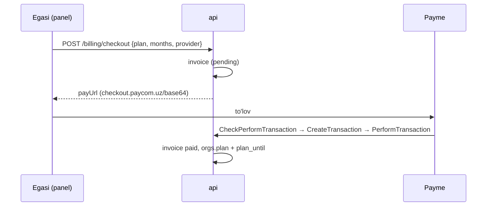

# 08 · Tarif va to'lov

Narxlar **namuna**: egalar narxni tasdiqlaguncha shunday. Yagona manba — `api/src/billing/plans.ts` (panel `GET /api/billing` dan o'qiydi).

| Tarif | so'm / oy | Operator | Kanal | Xabar | AI javob | Qo'ng'iroq, daq |
|---|---|---|---|---|---|---|
| Start | 0 | 1 | 2 | 300 | 100 | 0 |
| Biznes | 149 000 | 3 | 4 | 5 000 | 2 000 | 300 |
| Pro | 449 000 | 10 | ∞ | 30 000 | 15 000 | 2 000 |
| Korporativ | kelishiladi | ∞ | ∞ | ∞ | ∞ | ∞ |

Yillik to'lov = 12 oy −20%. Limit oyma-oy (Toshkent kalendari), limit tugasa API `402` qaytaradi, AI suhbatni operatorga topshiradi, kampaniya pauzaga tushadi.

## To'lov oqimi

| Provayder | Holat |
|---|---|
| Demo tashkilot | To'lov darhol «paid», tarif almashadi |
| Payme | Merchant API (`Check/Create/Perform/Cancel/CheckTransaction`, `GetStatement`) yozilgan, lokal JSON-RPC bilan sinalgan. ⏳ Payme sandbox'da rasmiy test |
| Click | To'lov havolasi va SHOP API: `POST /api/pay/click` (`Prepare`, `Complete`), imzo `CLICK_SECRET_KEY`. Lokal sinalgan. ⏳ Click test muhitida rasmiy sinov |

**Muddat.** Shu tarif uzaytirilsa qolgan vaqt saqlanadi. Boshqa tarifga o'tilganda yangi muddat shu kundan boshlanadi, eski tarifning qolgan vaqti ko'chmaydi. Muddat tugasa, soatlik tekshiruv tashkilotni `start` ga qaytaradi.

**Qaytarish.** Payme to'lovni bekor qilsa, oldingi tarif va muddat tiklanadi. Keyinroq boshqa to'lov bo'lgan bo'lsa, faqat shu to'lovning oylari ayriladi.
